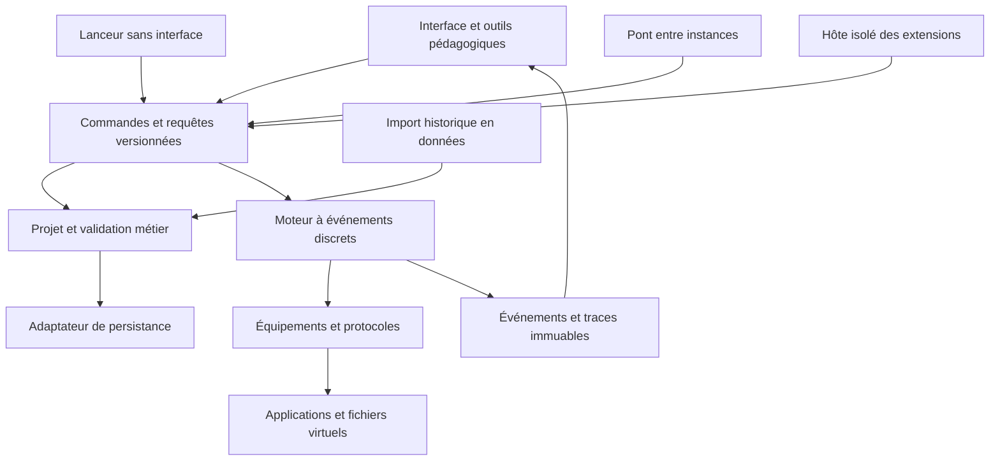

# Architecture indépendante de l’implémentation

## Réalisation J1

Le moteur de réseau local, les transactions d’édition et leurs frontières sont réalisés selon [LAN_J1](LAN_J1.md). La carte vers l’adaptateur actuel est dans la [matrice de traçabilité](../suivi/MATRICE.md); les identifiants fonctionnels restent portables.

## Choix directeur

Employer un moteur à événements discrets, autonome et déterministe. Les équipements et protocoles réagissent à des événements et programment leurs prochaines actions dans le temps virtuel. L’interface est un client du moteur, comme le lanceur sans interface et le runner de recettes.

Ce choix est une proposition de refonte. Le référentiel utilise de nombreux traitements concurrents, temporisations réelles et interactions entre modèles et interface; il ne faut pas transposer cette organisation classe par classe.

## Frontières

Les appels entre protocoles et applications passent par des interfaces internes explicites. Le diagramme représente les frontières de responsabilité, pas une obligation de déployer chaque bloc dans un processus distinct.

## Composants logiques

Les noms de la colonne composant correspondent exactement au champ `component` des exigences. Leur regroupement en bibliothèques reste un choix d’adaptateur.

| Composant | Responsabilité et approche |
| --- | --- |
| `engine` | Horloge virtuelle, file d’événements, exécution, arrêt, pause, pas à pas, graine et checkpoints |
| `topology` | Commandes d’édition, validation du graphe, sélection et historique réversible; coordonnées sans incidence réseau |
| `devices` | Types d’équipements, interfaces, ports et configuration; identité stable sans référence à l’UI |
| `link` | Trames, commutation, cache MAC et ARP; diffusions bornées et décisions explicables |
| `ipv4` | Adressage, sélection du prochain saut, TTL, ICMP et loopback |
| `routing` | Routes calculées, manuelles et dynamiques; politique de sélection versionnée et consultable |
| `transport` | Sockets virtuelles, ports, automates TCP et datagrammes UDP |
| `applications` | Catalogue, installation, services et clients/serveurs génériques; cycle de vie explicite |
| `filesystem` | Arbres de fichiers virtuels, contenus texte/binaires et import explicite de ressources |
| `terminal` | Commandes pédagogiques et alias; tâches interrompables, aucune délégation à un shell hôte |
| `dhcp` | Automates d’attribution, réservations, détection de conflit et repli link-local |
| `dns` | Enregistrements, résolveur, cache, délégations et temporisations bornées |
| `web` | Messages HTTP, racines, hôtes virtuels, pages dynamiques et rendu isolé |
| `nat` | Mappings et redirections; transformations explicites avec événements avant/après |
| `firewall` | Règles ordonnées, modes pédagogiques, politique par défaut et journal des décisions |
| `mail` | SMTP/POP3 pédagogiques, comptes, relais par domaine, boîtes et client |
| `p2p` | Découverte, recherche et transfert entre pairs avec TTL, identifiants et quotas |
| `observation` | Journal de référence, corrélation, filtres, projections, visualisations et exports de traces |
| `reporting` | Annotations, scène exportable, image et document de rapport à partir d’un instantané |
| `extensions` | Contrat d’applications personnalisées, capacités, limites et adaptateur du pont externe |
| `projects` | Schéma de scénario, migrations, écriture atomique, récupération et import historique |
| `platform` | Fenêtres, préférences, langues, raccourcis, fichiers et distribution desktop |
| `quality` | Contrats communs, lanceur de recettes, métriques, accessibilité et provenance |
| `future` | Études optionnelles séparées du chemin de parité |

## Ordonnancement

Un événement possède `(temps, priorité, séquence)`. Le temps est un entier dans une unité documentée. La séquence est attribuée par le moteur et départage les événements simultanés. La priorité est une politique publiée et versionnée, jamais l’ordre d’itération d’un conteneur.

Le moteur est l’unique auteur de l’état de simulation. Les commandes externes sont sérialisées à une frontière d’événement, numérotées et validées avant application. Une commande invalide ne modifie pas l’état. L’interface lit des projections et reçoit des lots d’événements; elle ne conserve pas de références modifiables vers les objets métier.

Les minuteries TCP, DHCP, RIP, caches et NAT sont des événements virtuels. Aucun délai de protocole ne dépend de la fréquence d’affichage. La vitesse modifie seulement l’écoulement du temps virtuel par rapport à la présentation. En mode sans interface, l’exécution avance directement au prochain événement.

## Piles et automates

Représenter un paquet par des données typées et une charge utile explicite. Séparer l’état de protocole du contenu transmis. Les automates retournent des actions : émettre, livrer, programmer une expiration, modifier une table ou abandonner avec une cause.

Le transport fournit des sockets simulées aux applications. Une socket virtuelle ne correspond pas à une socket du système d’exploitation. Les applications HTTP, DNS, mail et P2P utilisent cette même pile afin que leurs échanges restent observables.

Une matrice de fidélité est obligatoire avant chaque famille de protocole. Elle précise les états modélisés, champs visibles, timers, limites, erreurs et divergences assumées par rapport au protocole complet. Un champ présent mais non utilisé doit être marqué comme tel dans l’explication pédagogique.

## Configuration, exécution et présentation

| État | Exemples | Persistance |
| --- | --- | --- |
| Projet | Topologie, configurations, logiciels installés, fichiers, annotations, références d’extensions | Fichier de projet portable |
| Exécution | Horloge, file, états TCP, caches, routes apprises, mappings, messages en vol | Checkpoint explicite versionné; remise à zéro normale au démarrage |
| Données pédagogiques durables | Pages créées, comptes, messages enregistrés | Projet; règles de sauvegarde applicative explicites |
| Présentation | Zoom, sélection, panneaux ouverts, préférence de langue | Profil utilisateur ou section de vue séparée |
| Entrées externes | Trames du pont, actions utilisateur, décisions d’activation | Journal rejouable, avec ordre et instant d’injection |

Une transition vers la conception invalide la génération d’exécution courante, arrête les applications et ferme le pont. Les événements retardés portant une ancienne génération sont ignorés avec diagnostic. Les objets du projet restent disponibles.

## Traces et explications

Chaque échange reçoit un identifiant causal. Une trame, ses paquets encapsulés, ses transformations NAT et les livraisons applicatives peuvent ainsi être reliés. Une nouvelle transformation crée une représentation historique distincte; elle ne réécrit pas une ligne passée.

Séparer le journal des faits de ses projections : table par interface, vue par couches, animation, table NAT, rapports et statistiques. Masquer une couche ne supprime pas les faits. Une purge de trace est une action explicitement délimitée; elle ne purge pas les tables réseau.

Les buffers d’observation sont bornés. L’interface reçoit des lots et peut prendre du retard sans ralentir ni altérer les protocoles. Un débordement d’observation est signalé avec une plage manquante; il n’est pas transformé en perte réseau. Une saturation de la file moteur suit une autre politique, explicite et vérifiable.

## Projets et import

Le format portable décrit des données et non des objets exécutables. Une sauvegarde enregistre une version de schéma et un profil de sémantique. Les migrations sont testées sur des fixtures et préservent un original récupérable.

L’import du format historique doit interpréter une liste autorisée de structures connues, leurs identifiants et références, sans instancier leurs classes. Les fichiers sources et binaires personnalisés sont conservés comme pièces inactives ou signalés comme non convertis. Un rapport détaille ce qui a été compris et perdu.

## Extensions et ponts

Les extensions reçoivent exclusivement des capacités du simulateur : sockets virtuelles, fichiers virtuels, configuration et émission d’événements. Elles ont une version de contrat, un budget mémoire, un budget d’exécution et une politique d’arrêt. Leurs diagnostics ne doivent pas bloquer le moteur.

Le pont entre instances est une entrée externe non déterministe. Toute trame reçue est convertie en événement avec temps d’injection et séquence enregistrés. Un rejeu utilise cet enregistrement et n’ouvre pas le pont réel. Le protocole inter-instance doit être versionné; une compatibilité avec le transport historique n’est pas supposée.

## Passage à un autre adaptateur

Le comportement est fixé par les exigences, les contrats neutres et les fixtures. Les bibliothèques, représentations mémoire et outils de compilation peuvent changer sans changer ces références. Un changement de sémantique exige une décision, une version de profil et une recette mise à jour. Le nouvel adaptateur porte les mêmes identifiants fonctionnels et fournit ses propres preuves.

## Services J4

La [projection réseau effective et les services](SERVICES_J4.md) complètent le transport et le routage. Configuration sauvegardée, état des services et ressources des navigateurs restent distincts.

## Réseaux privés J5

Le [profil privé](RESEAUX_PRIVES_J5.md) fixe les rôles LAN/WAN et l’ordre filtrage, traduction et transfert. L’administration interne est un client des mêmes commandes transactionnelles que l’inspecteur.

## Évolution des adaptateurs

Le [processus d’évolution](EVOLUTION.md) fixe les tranches de refactor, les frontières et leurs preuves. Un changement d’organisation ne modifie ni les exigences ni les contrats de données. La carte des modules et les commandes restent propres à chaque adaptateur.

## Rapport documentaire

Le [profil de rapport J7](RAPPORTS_J7.md) décrit la capture, les sections, les échanges par MAC et les limites. Projet sauvegardé, réseau effectif et génération des faits restent distincts pendant l’export.

## Aide pédagogique

Le [guide contextuel](AIDE_J7.md) est une projection hors ligne des fonctions disponibles, séparée de leur exécution. Les liens de chargement d’exemples passent par les mêmes protections que les autres ouvertures de document.
