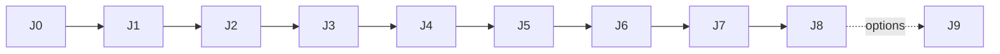

# Roadmap fonctionnelle

Cette roadmap est ordonnée par livrables vérifiables, sans calendrier artificiel. Les exigences affectées à chaque jalon figurent dans le catalogue et le registre; les dépendances `depends_on` sont les prérequis minimaux. Les portes de sortie ci-dessous ajoutent les validations intégrées qui ne se résument pas à une dépendance entre deux fiches.

J0 à J8 composent la trajectoire de réalisation; J9 regroupe les fonctions optionnelles et le retour éventuel d’une fonction retirée. Les tailles des lots sont relatives et doivent être réestimées après les prototypes. Une livraison J2 n’est pas une déclaration de parité complète.

## J0 — Fondations et contrats

**But :** figer le comportement du moteur, les frontières et les données avant de multiplier les protocoles.

- Stabiliser identité, temps, ordre des événements, erreurs, commandes, événements et format de scénario.
- Réaliser un moteur minimal sans interface, un runner et une trace canonique.
- Formaliser les schémas à partir des contrats proposés et créer leurs fixtures valides/invalides.
- Établir la politique de provenance et la matrice de fidélité initiale.
- Prototyper le canevas, l’inspection d’une grande trace et le rendu HTML isolé dans l’adaptateur retenu.

**Porte de sortie :** deux exécutions du même petit automate ont des traces identiques; les contrats sont versionnés; les entrées invalides sont rejetées; une décision documente les limites et le choix d’interface. Aucune dépendance graphique n’est nécessaire au lancement du moteur.

## J1 — Réseau local et conception

**But :** dessiner un LAN et observer un ping déterministe.

- Palette, hôtes, switch, interfaces, câblage, inspecteur, sélection et raccourcis.
- Ethernet, apprentissage MAC, rétention SAT, ARP, IPv4 local, loopback et ICMP.
- Début de sauvegarde/réouverture, annuler/rétablir, zoom et clavier.
- Démarrer/arrêter, pause/pas à pas, vitesse et pertes manuelles.
- Mesurer les budgets de capacité et de réactivité sur la machine de référence.

**Porte de sortie :** recette R-LAN réussie avec trace contrôlable; boucle de switches bornée; dix cycles de démarrage sans événement résiduel; édition/sauvegarde sans perte des données alors prises en charge. Les écrans des logiciels non encore réalisés ne doivent pas être annoncés comme utilisables.

## J2 — Première version utilisable

**But :** utiliser les hôtes, comprendre transport et transferts de texte.

- TCP/UDP, ports, sessions, réessais et arrêt propre.
- Bureau, registre des 13 logiciels et disponibilité explicite des logiciels réalisés.
- Client/serveur echo, système de fichiers virtuel, explorateur, import, éditeur et images.
- Terminal : commandes locales, IP, ARP, netstat, ping, capture, historique, interruption, exit/cls/reset.
- Historique par interface, vues agrégée/par couches, inspection, filtres de couche et export texte.

**Porte de sortie :** R-TCP et R-FICHIERS réussies; perte contrôlée suivie de retransmission sans doublon applicatif; une désinstallation libère le port; fermer une vue ne coupe pas son service. Les recettes des fonctions installables futures restent ouvertes.

## J3 — Réseaux routés et explications

**But :** relier des LAN et expliquer le choix du chemin.

- Routeur multi-interface et réaffectation de connexions.
- Routes directes, défaut, statiques, transfert sur hôte et TTL.
- RIP pédagogique, annonces, métriques et expiration.
- Traceroute, diffusion explicite, injection ARP simulée et affichage des routes.
- Causes structurées de transfert et d’abandon.

**Porte de sortie :** R-ROUTES et R-RIP réussies; la trace d’un traceroute commence avec TTL=1; une absence de route et une expiration sont distinguables. Le comportement de sélection et ses différences historiques sont documentés.

## J4 — Services d’infrastructure et web

**But :** exécuter un exercice complet DHCP → DNS → HTTP.

- DHCP : plage, réservations, offres, conflits, attribution et link-local.
- DNS : A/MX/NS, délégations, récursion, persistance et normalisation.
- Cache de résolution à TTL comme amélioration explicite.
- HTTP GET/POST, serveur, fichiers et images, hôtes virtuels, navigateur isolé.
- Paramètres réseau actualisés dans l’hôte et commandes de résolution.

**Porte de sortie :** R-DHCP et R-WEB réussies hors ligne; les images de deux hôtes ne se contaminent pas; le navigateur ne peut pas sortir du réseau simulé; la suppression d’un enregistrement reste effective après rechargement.

## J5 — Réseaux privés et filtrage

**But :** simuler la frontière LAN/WAN et la configuration d’un routeur domestique.

- NAT TCP/UDP, collisions de ports, redirections statiques et tables expirables.
- ICMP/traceroute à travers NAT, WAN DHCP et distribution LAN.
- Pare-feu d’hôte/routeur, règles ordonnées, politique par défaut, ICMP et modes TCP/UDP pédagogiques.
- Administration web, consultation des routes et des journaux, vues NAT actualisées.

**Porte de sortie :** R-NAT et R-FILTRE réussies; captures avant/après NAT immuables; deux hôtes utilisant les mêmes ports ne confondent pas leurs réponses; WAN et LAN ne sont jamais intervertis.

## J6 — Applications et connexions avancées

**But :** couvrir les usages mail, P2P, SSID et réseaux entre instances.

- SMTP/POP3, comptes, relais MX, client mail, messages et contacts exposés par le modèle.
- Gnutella pédagogique : voisins, recherche, résultats, téléchargement et annulation.
- Association Wi-Fi par SSID et rupture propre en cas de changement.
- Modem client/serveur, tunnel borné, états de connexion et capture des entrées externes.

**Porte de sortie :** R-MAIL, R-P2P et R-PONT réussies; aucun service mail réel n’est contacté; un changement de SSID déconnecte les bons hôtes; un tunnel interrompu ne bloque pas l’UI et ses entrées sont enregistrées pour la recette de rejeu de J7.

## J7 — Scénarios portables et expérience de livraison

**But :** rendre le produit partageable, récupérable et documentable.

- Import .fls et rapport détaillé sur les 18 exemples; préserver les pièces non converties inactives.
- Autosauvegarde, session restaurée, checkpoints/rejeu et pannes paramétrées.
- Annotations, PNG, PDF, exports structurés, recherche et parcours entre couches.
- Duplication, alignement, préférences, FR/EN/DE, aide et exemples remis à jour.
- Distribution sur trois OS, association de fichiers et validation d’accessibilité.

**Porte de sortie :** R-IMPORT, R-REPRISE et R-RAPPORT réussies; parcours minimum validé sur chaque OS; contrôle visuel des exports et des textes traduits; tous les écarts de conversion connus sont visibles. Un fichier importé avec extension historique n’est pas exécuté automatiquement.

## J8 — Extensions et fermeture de la parité

**But :** remplacer l’assistant historique et fermer la couverture fonctionnelle.

- Assistant, modèles client/serveur, édition, compilation et diagnostics.
- Contrat d’applications/pages personnalisées et catalogue.
- Emballage dans les projets, capacités et quotas d’exécution.
- Rejouer les recettes de toutes les familles, compléter les matrices de fidélité et documenter les divergences restantes.

**Porte de sortie :** R-EXT réussie, toutes les exigences requises de J0–J8 vérifiées et toutes les réserves de livraison résolues ou explicitement décidées. Les primitives internes sont couvertes par API; aucune compatibilité binaire des extensions historiques n’est annoncée. Les exemples personnalisés sont portés vers le nouveau contrat.

## J9 — Évolutions optionnelles

Réintroduction éventuelle de SVG, IPv6/NDP, VLAN et prévention normalisée des boucles, protocoles avancés/chiffrement, exercices évaluables, édition collaborative et exécution navigateur. Chaque lot commence par une décision de périmètre et de fidélité. Il ne bloque pas la parité J8.

## Chemin critique et risques

Cette chaîne représente l’ordre de livraison proposé. Certains travaux d’interface et d’export pourront avancer plus tôt une fois leurs contrats et prérequis stabilisés.

| Risque | Tranche de réduction | Critère de décision |
| --- | --- | --- |
| Moteur non déterministe | J0 | Ordre des événements et traces identiques avant de développer TCP |
| Rendu web sortant du simulateur | Prototype J0, livraison J4 | Liens, formulaires et images exclusivement alimentés par la pile virtuelle |
| Automate TCP trop vaste | J2 | Sous-ensemble pédagogique explicite, pertes/retransmissions et fermeture vérifiés |
| NAT et pare-feu incohérents | J5 | Fixtures d’ordre des transformations et réponses ICMP encapsulées |
| Conversion .fls incomplète | Exploration dès J0, livraison J7 | Rapport sur chaque classe/propriété inconnue et corpus des 18 exemples |
| Extensions non maîtrisées | Prototype isolé avant J8 | Quotas effectifs et absence de capacités hôte implicites |
| Coût UI des traces | J0 puis J7 | Pagination et mesures sur la charge de référence |

## Règle de clôture

Un jalon est fermé lorsque ses exigences requises et ses recettes intégrées ont des preuves. Un changement de bibliothèque ne réinitialise pas les exigences; un changement de comportement exige de mettre à jour le contrat, la recette et le profil de sémantique. Aucun pourcentage d’avancement n’est déduit du nombre de lignes écrites.
