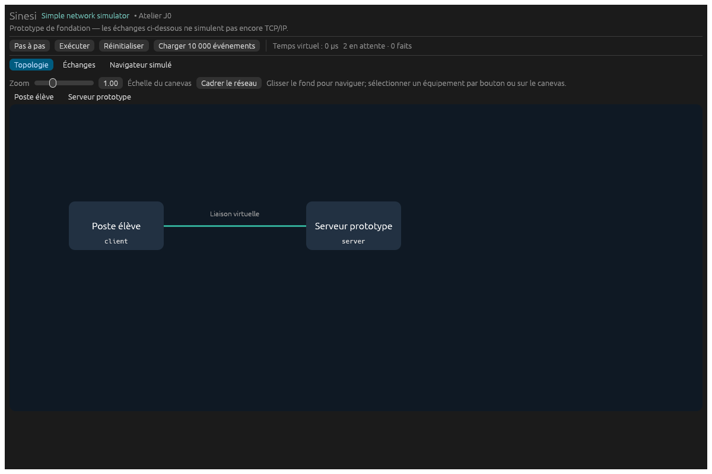
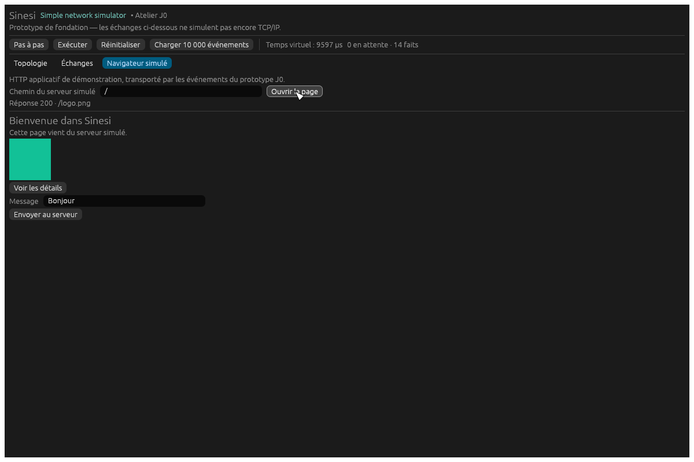

# Vérification du socle J0 — Sinesi

Réalisation locale du 7 novembre 2026, macOS arm64, toolchain Rust 1.95.0. Le workspace utilise la famille graphique upstream 0.37.0; les versions sont verrouillées dans Cargo.lock. Ce rapport couvre la tranche demandée : initialisation, moteur minimal et prototypes natifs. Il ne clôt pas toutes les recettes transversales de J0 ni les protocoles des jalons suivants.

## Livrables exécutables

| Livrable | Preuve |
| --- | --- |
| Workspace et CLI indépendants de l’UI | Cargo.toml, rust-toolchain.toml, Cargo.lock et vérification du graphe de production |
| Modèles et cinq schémas neutres | tests de contrats structurels, sérialisation réelle et invariants métier |
| Ordonnancement stable, graine, bornes et commandes | sept tests d’intégration moteur; comparaison de traces canoniques et fixture de référence |
| Sauvegarde atomique et migration de qualification | tests de roundtrip, version inconnue, original conservé et échec de remplacement |
| Deux processus indépendants | test CLI `independent_processes_emit_identical_traces_and_honor_bounds` |
| Canevas, zoom, sélection clavier | tests de widgets réels et capture wgpu inspectée |
| Charge de 10 000 faits | 5 000 messages réellement exécutés par le moteur; table virtualisée testée |
| Page, image, lien et POST natifs | tests parseur/UI et contrôle dans la fenêtre macOS |
| Traçabilité | contrôle documentaire et deux tests de refus d’une vérification sans preuve/prérequis |

## Commandes et résultats locaux

| Commande | Résultat |
| --- | --- |
| `cargo fmt --all --check` | Réussi |
| `cargo clippy --workspace --all-targets --locked -- -D warnings` | Réussi |
| `cargo test --workspace --locked` | 23 tests réussis; aucun échec |
| `cargo test -p sns-ui-egui --features ui-snapshots --test workbench --locked` | 5 tests réussis, dont captures GPU comparées aux références |
| `cargo build -p sns-desktop --locked` | Binaire natif construit |
| `cargo run -p sns-cli --locked --offline -- run fixtures/valid/scenario.json --seed 42 --trace fixtures/valid/trace.jsonl` | 6 événements exécutés, 0 restant, temps final 7 284 µs |
| `python3 scripts/check_layers.py` | Aucun runtime graphique/réseau ni module Craft dans les dépendances headless de production |
| `python3 scripts/test_docs.py` | 2 tests négatifs réussis |
| `python3 scripts/docs.py check --require-reference` | Contrôle du suivi et du corpus local requis en fin de livraison |

Trace de référence SHA-256 : `e092ec57791faf3b43604f4bdbaf607c8feaf6eac114df2f81821034f71bd7db`.

Les journaux [workspace](j0-tests.log), [UI/GPU](j0-gpu-tests.log) et [lint](j0-clippy.log) accompagnent ce rapport. La [matrice de fidélité](../agnostique/FIDELITE.md) distingue les prototypes des protocoles futurs. Les captures ont été créées pour cette première référence, inspectées visuellement, puis les tests ont été relancés **sans** activation de leur mise à jour automatique.

## Contrôle de la fenêtre native

Le binaire a été ouvert dans un bundle de développement temporaire sous `target/Sinesi.app`, hors Git. La fenêtre porte le titre « Sinesi — Simple network simulator ». L’arbre d’accessibilité expose les commandes, onglets, zoom et sélections d’équipements.

Parcours observé : ouvrir « Navigateur simulé », cliquer « Ouvrir la page », constater le texte et l’image avec réponse 200, puis « Envoyer au serveur ». Le résultat affiche `message=Bonjour`, réponse 200 de `/echo`, 18 faits et 0 événement en attente. Cette preuve native complète les tests de widgets et de rendu; elle ne valide pas encore les autres OS ou les parcours multi-écran/IME.

## Captures du prototype

## Limites conservées dans le suivi

- Les livraisons sont des messages de prototype, pas des trames Ethernet ou sessions TCP/IP. Le service applicatif sert à vérifier les frontières du navigateur et du moteur.
- Les recettes hors ligne LAN/DNS/HTTP sur une pile complète ne sont pas satisfaites par ce prototype; F-NFR-001 reste en cours.
- Le lecteur J0 refuse ZIP/XML au lieu de les exécuter. L’import historique sûr avec rapport de conversion reste à développer; F-NFR-006 reste en cours.
- Les bibliothèques Craft, dialogues rfd, export PNG/PDF produit, polices avancées et plugins ne sont pas intégrés à cette tranche.
- La CI Windows/Linux/macOS est ajoutée mais ses jobs distants ne sont pas annoncés comme exécutés. Le dépôt distant n’est pas publié par cette vérification locale.
