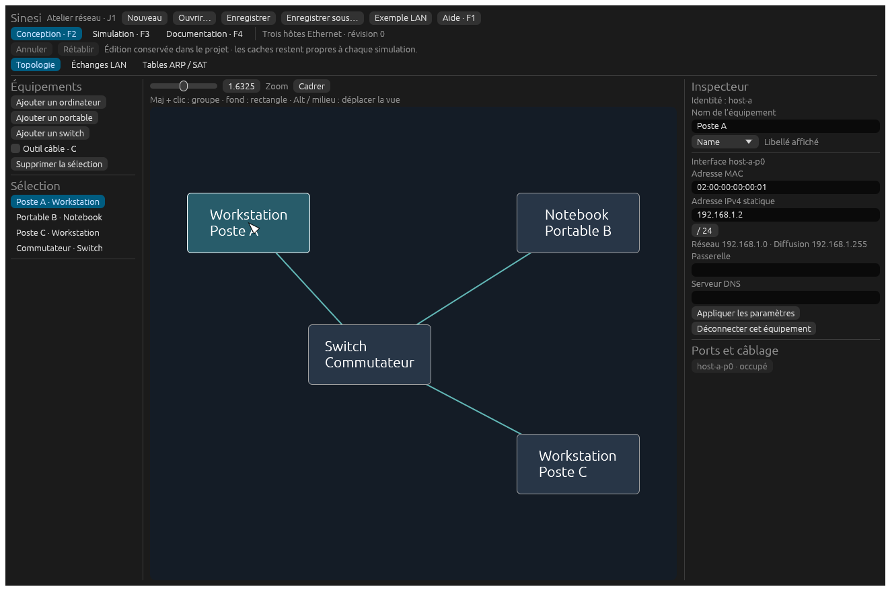

# Vérification J1 — édition et réseau local

Date : 7 novembre 2026. Les 28 exigences J1 et les 7 lots associés sont vérifiés pour le sous-ensemble défini dans [LAN_J1](../agnostique/LAN_J1.md). Les fichiers réalisés figurent dans [taches.json](../rust/taches.json); les exigences et prérequis dans [features.json](../suivi/features.json).

Le code testé est identifié par [j1-code-manifest.json](j1-code-manifest.json), révision d’inventaire `05abe391095f4954a1ae1e6724dedaa53f6a9890449ce4bb7dd63bc6ca2a9bd9`. Le manifeste inclut code, manifests, lockfile, contrats, fixtures, scripts et CI. Le manifeste J0 reste une preuve historique distincte. Ce manifeste identifie les sources de J1 à sa qualification; les évolutions J2 sont identifiées séparément dans le [rapport J2](J2.md).

## Porte de sortie

| Recette | Résultat et preuve |
| --- | --- |
| R-LAN à trois hôtes | ARP broadcast puis réponse, apprentissage MAC, echo request/reply; aucune livraison IP au troisième hôte lors du ping A→B; échanges ensuite entre les trois hôtes. [Tests](../../crates/sns-engine/tests/lan.rs) |
| Réutilisation et purge | Deux pings réutilisent ARP, purge immédiate, nouvelle résolution, SAT configurable et expirations virtuelles gardées; résolutions simultanées conservent leurs corrélations |
| Déterminisme | Même trace en pas à pas, exécution bornée et continue; mêmes octets avec les listes réordonnées et jitter fixé; réception liée à sa propre émission |
| Boucles | Triangle de commutateurs terminé sous 200 événements, abandon `switch.loop_detected`; aucune file infinie |
| Cycle de vie | Dix arrêts/redémarrages avec tables/file vidées, nouvelle génération et aucun ancien fait; pause et pertes manuelles testées |
| Édition | Ajout bouton/dépôt, rectangle, mouvement de groupe, câbles attachés, suppression, annuler/rétablir, paramètres/identités, erreurs transactionnelles. [Éditeur](../../crates/sns-topology/tests/editor.rs), [UI](../../crates/sns-ui-egui/tests/lan.rs) |
| Persistance | Projet LAN sauvegardé/réouvert à l’identique, logiciels/fichiers/annotations conservés; protection des changements; versions J0/LAN distinguées. [Contrats](../../crates/sns-project/tests/contracts.rs) |
| Clavier | Créer/configurer deux hôtes, relier leurs ports, envoyer et inspecter un echo uniquement avec focus/Entrée/saisie; raccourcis non interceptés dans un champ |
| Erreurs | Pas de route, résolution ARP expirée, TTL nul et erreurs ICMP filaires d’une passerelle distingués; dépassements de quota/date sans consommation de l’événement en échec |
| Corpus Filius | 18 exemples inspectés en lecture seule; classes inconnues et code embarqué signalés sur fixture hostile; aucune classe exécutée. [Inventaire](j1-filius-inventory.json), [tests](j1-filius-tests.log) |

Une [trace canonique de deux pings](j1-lan.jsonl) et son [résultat CLI](j1-lan-result.json) sont conservés. Reproduction :

```sh
cargo run -p sns-cli --locked -- ping fixtures/valid/lan.json --source host-a --target 192.168.1.3 --count 2 --trace target/lan.jsonl
```

## Contrôles exécutés

Environnement : macOS 27.2 arm64, Apple M2 Max, 64 Gio de RAM, Rust 1.95.0. Les informations exactes sont dans [j1-environment.json](j1-environment.json).

| Commande | Résultat |
| --- | --- |
| `cargo fmt --all --check` | Réussi, [journal](j1-fmt.log) |
| `cargo clippy --workspace --all-targets --locked -- -D warnings` | Réussi sans avertissement, [journal](j1-clippy.log) |
| `cargo test --workspace --locked` | 45 tests réussis; mesure de charge ignorée volontairement dans cette commande, [journal](j1-tests.log) |
| `cargo test -p sns-ui-egui --features ui-snapshots --test lan --test workbench --locked` | 12 tests réussis, dont deux tests de comparaison GPU couvrant trois captures, [journal](j1-gpu-tests.log) |
| `cargo test -p sns-ui-egui --lib reference_load --locked -- --ignored --nocapture` | Mesure exécutée séparément avec succès, [journal](j1-benchmark.log) |
| `cargo build -p sns-desktop --locked` | Binaire natif construit, [journal](j1-desktop-build.log) |
| `python3 scripts/check_layers.py` | Cœur sans GUI, Craft ni runtime réseau, [journal](j1-layers.log) |
| `python3 scripts/test_filius_inspection.py` | Deux tests réussis : inconnus/code inertes et refus d’entrées invalides |
| `python3 scripts/inspect_filius.py _archive/filius-master/beispiele/*.fls` | 18 exemples, zéro classe absente du lexique d’inventaire; ce lexique n’est pas une liste d’importeurs |
| `python3 scripts/docs.py render`, `check --require-reference`, `scripts/test_docs.py` | Suivi, liens, prérequis, séparation et référence historique; [journal](j1-docs.log) |

## Mesure de capacité

Charge déterministe : 50 hôtes et 50 switches, 150 liens dont des boucles, 40 sondes initiales. Budget volontairement arrêté à **10 000 événements**, produisant 27 093 faits. Profil dev : code du workspace non optimisé, dépendances optimisées au niveau 2.

| Mesure | Valeur observée |
| --- | ---: |
| Calcul moteur, 10 000 événements | 5 219,624 ms |
| Topologie, 100 frames, p95 CPU | 1,818 ms |
| Table des 27 093 faits, 100 frames, p95 CPU | 1,105 ms |
| Mémoire résidente maximale du processus de test compilé | 150 568 960 octets, environ 143,6 Mio |

La mesure CPU comprend layout et arbre accessible egui en 1 320 × 880; elle exclut GPU, affichage, dialogues natifs et latence des commandes en charge. La mémoire est mesurée via `/usr/bin/time -l` sur le binaire de test compilé, sans compilateur. Il s’agit d’une observation sur cette machine, sans seuil contractuel de débit ni garantie sur d’autres OS. Le benchmark atteint volontairement son budget et conserve des événements; la terminaison des boucles est vérifiée par un autre test. Les clones transactionnels et de projection restent une piste d’optimisation pour les charges plus fortes.

## Parcours natif et rendu

Le binaire final a été lancé dans une fenêtre native macOS : sélection de Poste A, simulation en pause, ping, reprise, pause, filtre et inspection de `icmp.echo.reply`, événement `evt-37`, source `192.168.1.3`, RTT `8000` µs, corrélation `lan-ui-1`. Les dialogues natifs enregistrer/ouvrir ont aussi été parcourus pendant la session J1; le document sauvegardé est sémantiquement identique à la fixture. [Compte rendu natif](j1-native-smoke.json).

Le rendu de référence a été inspecté visuellement et les captures J0 conservées :



## Limites et suite

La porte J1 est satisfaite pour le profil pédagogique documenté. Les erreurs ICMP de passerelle ne constituent pas du routage inter-réseaux; celui-ci reste J3. TCP/UDP et le catalogue de logiciels restent J2, DHCP/DNS/HTTP complets les jalons suivants. L’inventaire `.fls` ne réalise aucune conversion historique. Les contrats ne représentent pas un encodage filaire complet.

Les essais natifs Windows/Linux et la CI distante n’ont pas été exécutés localement. Les exigences transversales F-NFR-001 et F-NFR-006 et le lot RS-QUALITY-J0 restent en cours : leurs recettes dépassent J1. Le chantier suivant est J2; ne pas transformer les prototypes applicatifs J0 en revendication de protocoles déjà implémentés.
