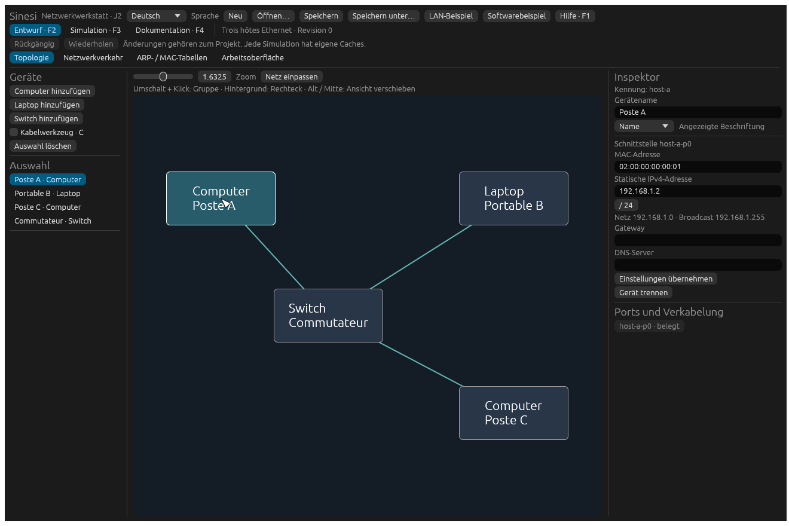

> Photographie historique de la fondation J2. La réalisation complète et ses preuves sont désormais dans [J2](J2.md); ne pas utiliser les prochaines actions ci-dessous comme état courant.

# J2 — preuve intermédiaire, jalon encore ouvert

Cette étape réalise le cœur transport, le système de fichiers autonome et la localisation des écrans existants. **L’objectif utilisateur reste actif et le jalon J2 n’est pas terminé.** Le bureau, les logiciels et le terminal n’existent pas encore comme parcours produit complet; les recettes R-TCP et R-FICHIERS de sortie restent à passer avec eux.

## Code contrôlé

Le [manifeste de cette étape](j2-foundation-manifest.json) identifie 81 fichiers source/configuration/contrat/fixture, révision `54f9078c18c9ab490b078232bb85af288a4a6cd79bec877db00678877652fe8d`. Ce manifeste est un instantané intermédiaire, pas une déclaration de livraison J2. Les sources J1 ont été comparées à leur manifeste avant le début de cette étape; leur comportement reste couvert par les régressions courantes.

| Contrôle exécuté | Résultat |
| --- | --- |
| `cargo test --workspace --locked` | **65 tests réussis**, benchmark de référence toujours ignoré par défaut. [Journal](j2-foundation-tests.log) |
| `cargo clippy --workspace --all-targets --locked -- -D warnings` | Réussi sans avertissement. [Journal](j2-foundation-clippy.log) |
| `cargo fmt --all --check` | Réussi. [Journal](j2-foundation-fmt.log) |
| `cargo test -p sns-ui-egui --features ui-snapshots --test lan --test workbench --locked` | **15 tests réussis**, neuf captures comparées dont les six langues et les références J0. [Journal](j2-foundation-gpu.log) |
| `cargo build -p sns-desktop --locked` | Binaire natif construit. [Journal](j2-foundation-build.log) |
| `python3 scripts/check_layers.py` | Cœur sans GUI/runtime réseau; nouveaux VFS et i18n inclus. [Journal](j2-foundation-layers.log) |
| `python3 scripts/docs.py check --require-reference` et `scripts/test_docs.py` | Suivi, prérequis, liens, séparation et référence historique. [Journal](j2-foundation-docs.log) |

Environnement : macOS arm64, Rust 1.95.0, mêmes dépendances graphiques verrouillées que J1. Aucun essai natif J2 n’est revendiqué sur la base du seul build; les vérifications d’interaction et de rendu de cette étape sont faites par egui_kittest. La CI distante n’a pas été exécutée.

## Transport vérifié comme composant

[transport.rs](../../crates/sns-engine/tests/transport.rs) contient dix tests d’intégration utilisant réellement Ethernet/ARP/IP :

- deux clients, endpoints distincts, flux segmentés et texte multioctet préservé;
- perte de données puis d’ACK : retransmission et livraison de chaque octet une seule fois;
- ACK final du handshake perdu : aucune seconde acceptation/connexion;
- conflits de ports et commandes invalides transactionnels, arrêt par propriétaire et réutilisation du port;
- FIN/ACK, vidage avant fermeture, TIME_WAIT et aucune résurrection par une minuterie périmée;
- cible muette : quatre réessais puis timeout borné; loopback sans Ethernet;
- UDP sans retransmission, diffusion avant configuration IP sur le LAN seulement;
- pas à pas et exécution continue avec trace canonique identique;
- écoute UDP par interface, abandon sur port absent;
- quota de trace et refus TCP d’une diffusion sans réservation résiduelle.

Les [tests de contrats](../../crates/sns-project/tests/contracts.rs) valident les commandes et les trames réellement sérialisées, ainsi que le rejet d’une séquence TCP hors limites. La [fidélité transport](../agnostique/TRANSPORT_J2.md) décrit les limites de ce sous-ensemble.

Ces preuves permettent de fermer les sept exigences de transport et RS-TRANSPORT-J2. Elles **ne prouvent pas** un bureau ou un logiciel echo : le renvoi serveur du test bas niveau est commandé par la recette via les sockets. La recette R-TCP globale exige encore de le faire au travers des vrais logiciels, de fermer leurs vues et de désinstaller le service.

## Fichiers et langues : avancement sans fermeture globale

Les trois [tests VFS](../../crates/sns-vfs/tests/files.rs) couvrent isolation, texte/binaire, copie/déplacement/suppression, normalisation, erreurs atomiques, limites et codec de persistance. L’explorateur, l’import, l’éditeur et l’afficheur restent à raccorder à ce cœur et au document actif.

Les catalogues contiennent **193 clés dans six langues**; les paramètres de chaque traduction correspondent et aucun libellé ne fait de fallback vers une autre langue. Les tests de préférences couvrent la persistance et la lecture invalide sans écrasement. Les tests UI changent les langues par le sélecteur et vérifient que le projet reste inchangé. Les nouveaux projets et les types affichés utilisent la langue sélectionnée.

Le rendu FR, DE et PT a été inspecté visuellement; les six captures sont conservées. Les libellés de projet/hôtes en français dans les autres langues sont des valeurs utilisateur de la fixture, conservées volontairement.

Le prototype de qualification `--prototype-j0` conserve ses écrans historiques; il ne sert pas de bureau J2. F-CFG-001 reste en cours jusqu’à la localisation des nouveaux bureaux, logiciels, sorties et aides du terminal et à leur validation de bout en bout.

## Suite de l’objectif

Continuer selon [l’état de reprise](../suivi/ETAT.md) et la [carte technique](../rust/J2-EN-COURS.md). Ne pas réduire le périmètre aux fondations présentes et ne pas déclarer J2 terminé tant que ses recettes produit et les six langues sur ses écrans ne sont pas vérifiées.
