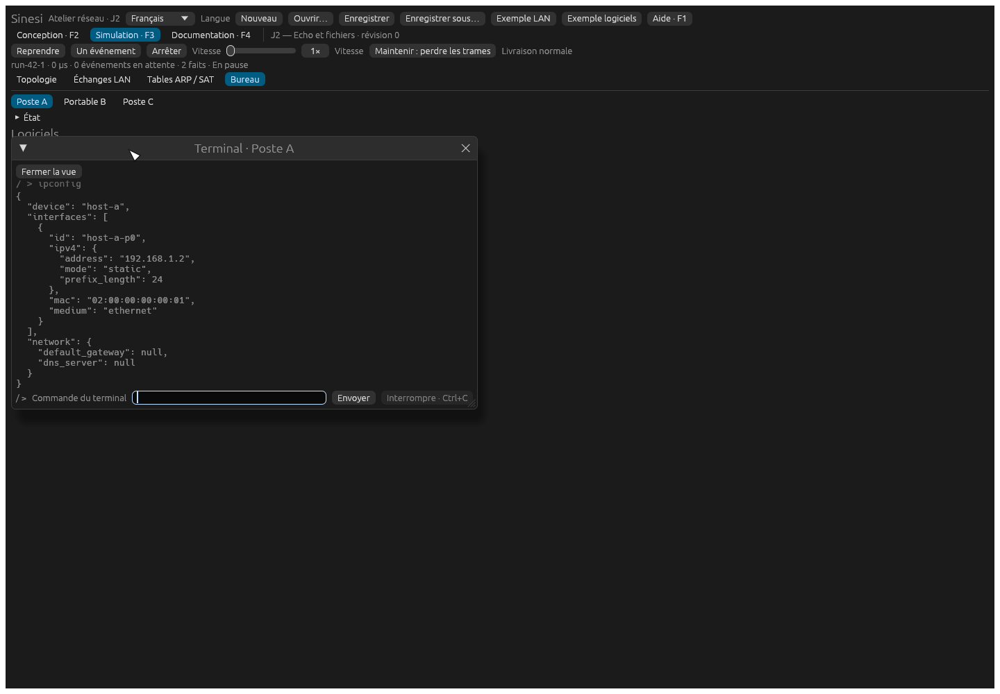

> Qualification historique du jalon J2. Les sources actuelles et l’extension suivante sont identifiées par le [rapport J3](J3.md).

# Vérification J2 — transport, logiciels, fichiers et six langues

Date : 7 novembre 2026. Les 40 exigences et les six lots J2 sont qualifiés localement pour les sous-ensembles [transport](../agnostique/TRANSPORT_J2.md) et [hôtes](../agnostique/HOTES_J2.md). Les jalons futurs du catalogue restent ouverts. La réalisation figure dans [J2 Rust](../rust/J2.md).

Le [manifeste J2](j2-code-manifest.json) identifie les sources, contrats, dépendances, fixtures, scripts et captures. Commande : `python3 scripts/check_manifest.py check docs/verification/j2-code-manifest.json`. Les manifestes J0, J1 et de fondation J2 sont conservés comme preuves historiques, sans revendiquer qu’ils identifient ces nouvelles sources.

## Recettes et critères

| Porte / exigences | Assertions et preuves |
| --- | --- |
| R-TCP / F-TCP-001 à 005, F-UDP-001/002 | Tests [transport](../../crates/sns-engine/tests/transport.rs) : sockets/ports/interfaces, deux clients, ACK/FIN/RST, TIME_WAIT, expiration, pertes de segment/ACK sans doublon, UDP sans retransmission et broadcast LAN |
| R-TCP / F-OS-003/005/006 | Tests [applications](../../crates/sns-engine/tests/applications.rs) : vrai serveur echo automatique, deux clients séparés, texte Unicode sur plusieurs segments, perte contrôlée puis retransmission, exactitude des octets, arrêt/désinstallation libérant le port; fermer la vue garde le service |
| R-FICHIERS / F-FS-001 à 005 | [VFS](../../crates/sns-vfs/tests/files.rs), applications et [GUI](../../crates/sns-ui-egui/tests/lan.rs) : isolation A/B, dossiers, copie/renommage/suppression, texte UTF-8, sauvegarde/sauvegarde sous, réouverture, image rendue avec octets inchangés, refus de collision et conservation du brouillon après échec |
| R-FICHIERS / import et écriture interrompue | Import et sauvegarde réellement parcourus dans les dialogues natifs; [projet sauvegardé](j2-native-project.json) et [empreinte de l’image](j2-native-smoke.json). Les tests `sns-project` conservent le fichier précédent après validation/rename en échec |
| F-OS-001/002 | Catalogue de 13 logiciels; six utilisables, futurs logiciels explicitement indisponibles; installations persistantes, vues et journaux par hôte; parcours du bureau dans les six langues |
| F-CLI-001 à 009, 011/012/014/016/018/020/021 | Aide/syntaxe, alias, chemins, isolation, netstat et ARP ciblé/global, quatre pings par défaut, statistiques, broadcast explicite, capture, interruption; historique au clavier, exit/cls/reset; aucune invocation de shell |
| F-OBS-001 à 005/010 | Trames par interface/direction/protocole et corrélation, sous-objets historiques par couche, filtres, suivi, purge d’affichage, export des mêmes lignes; activité des liens remise à zéro hors simulation |
| F-CFG-001 | 274 clés × FR/EN/ES/IT/PT/DE, paramètres identiques, diagnostics et aide; tests d’interaction terminal/éditeur/image dans les six langues; préférence persistante hors projet, document intact lors du changement de langue |
| Atomicité et contrats | Échec d’écoute occupée conservant document/révision/runtime/trace, identifiant dupliqué et révision périmée refusés; [contrats](../../crates/sns-project/tests/contracts.rs) testant projet 3, commandes, faits 2/3/4, champs inconnus et incompatibilités |

Les recettes déterministes utilisent `fixtures/valid/lan.json`, graine 42, et les séquences ordonnées dans les tests cités. Les [traces echo](j2-echo.jsonl) et [fichiers](j2-files.jsonl), avec leurs [projets echo](j2-echo-project.json) / [fichiers](j2-files-project.json), sont conservées. Reproduction depuis la racine :

```sh
SNS_RECORD_J2="$PWD/docs/verification" cargo test -p sns-engine --test applications --locked
```

Le test echo avec perte est borné à 100 000 µs pendant la perte, puis deux secondes virtuelles supplémentaires pour la retransmission. Les autres recettes et leurs bornes sont explicites dans les tests; le journal de commande est leur code source, et non une prétention à un format de replay applicatif déjà livré.

## Commandes exécutées

Environnement détaillé : [j2-environment.json](j2-environment.json), macOS arm64 / Rust 1.95.0.

| Commande | Résultat |
| --- | --- |
| `cargo fmt --all --check` | Réussi, [journal](j2-fmt.log) |
| `cargo test --workspace --locked --offline` | 78 tests réussis, une mesure de capacité volontairement ignorée, [journal](j2-tests.log) |
| `cargo clippy --workspace --all-targets --locked --offline -- -D warnings` | Réussi sans avertissement, [journal](j2-clippy.log) |
| `cargo test -p sns-ui-egui --features ui-snapshots --test lan --test workbench --locked --offline` | 22 tests réussis, comparaisons GPU sans mise à jour des références, [journal](j2-gpu.log) |
| `cargo build -p sns-desktop --locked --offline` | Binaire construit, [journal](j2-build.log) |
| `python3 scripts/check_layers.py` | Graphe de production indépendant de GUI/Craft/runtime réseau, [journal](j2-layers.log) |
| `python3 scripts/check_i18n.py` | Six langues, clés littérales et absence de templates affichés sans expansion, [journal](j2-i18n.log) |
| `python3 scripts/docs.py render`, `check --require-reference`, `scripts/test_docs.py` et `scripts/test_filius_inspection.py` | Suivi, séparation, prérequis et archive en lecture seule, [journal](j2-docs.log) |

Les références graphiques comprennent l’éditeur dans six langues, le bureau/terminal dans six langues et les captures de qualification existantes. FR et DE ont été inspectées après correction des libellés et placement des fenêtres :



## Portée et limites réelles

Le parcours natif a observé sélection explicite d’un PNG, copie vers `/import.png` sur Poste A, affichage puis sauvegarde. Les octets relus dans le projet correspondent exactement aux 104 octets choisis. Le [compte rendu](j2-native-smoke.json) identifie le binaire de cet essai; des corrections ultérieures de libellés, placement et accessibilité sont couvertes par les tests finaux et captures GPU. Aucun essai natif Windows/Linux ni CI distante n’est revendiqué.

Le transport reste pédagogique, sans conformité TCP complète. DNS, DHCP, HTTP, routage et logiciels futurs ne sont pas réalisés par leur seule présence au catalogue. GIF affiche sa première image. Les dialogues natifs sont modaux et leurs contrôles système utilisent la langue de l’OS. Les traces conservent des noms/champs de protocole stables; les données utilisateur ne sont pas traduites. Les connexions et jobs ne sont pas persistés lors de l’enregistrement du projet.

F-NFR-001/F-NFR-006 et RS-QUALITY-J0 restent en cours pour les recettes transversales. Les seuils de performance J1 restent des observations historiques; ils n’ont pas été remesurés sur ce nouveau code. La prochaine tranche de la roadmap est J3.
