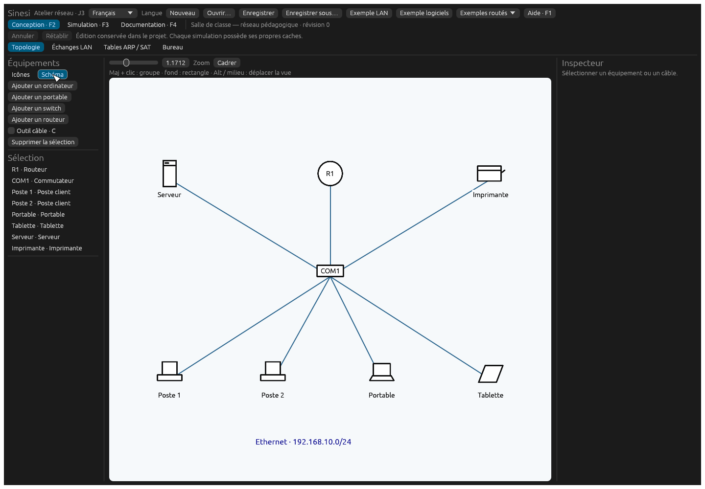

# Vérification J3 — routage, TTL/traceroute, RIP et schémas

Date : 7 novembre 2026. J3 couvre les 14 exigences de sa roadmap et F-TOP-011, ajoutée explicitement pour les représentations pédagogiques fournies. Les sept lots sont reliés au [registre fonctionnel](../suivi/features.json) et au [plan technique](../rust/taches.json). La portée est définie par [ROUTAGE_J3](../agnostique/ROUTAGE_J3.md), la réalisation par [J3 technique](../rust/J3.md).

Les sources finales, contrats, fixtures, scripts, lockfile et assets sont identifiés par [j3-code-manifest.json](j3-code-manifest.json). Vérification : `python3 scripts/check_manifest.py check docs/verification/j3-code-manifest.json`. Les preuves et captures J0/J1/J2 restent historiques et préservées; leurs manifestes ne prétendent pas identifier les nouvelles sources.

## Portes de sortie et preuves

| Porte / exigences | Assertions effectivement testées |
| --- | --- |
| R-ROUTES / F-EQU-003, F-TOP-005 | Routeur multi-interface, redimensionnement et échanges conservant identités/autres liens, refus transactionnels et undo; [éditeur](../../crates/sns-topology/tests/editor.rs) |
| R-ROUTES / F-IP4-003, F-ROUT-001/002/003 | Trois LAN et deux routeurs, IP d’origine conservées, TTL 64→63→62, retour echo, TTL=1 et erreur ICMP filaire, plus spécifique/défaut/suppression, transfert sur hôte actif/inactif; [routage](../../crates/sns-engine/tests/routing.rs) |
| R-ROUTES / F-CLI-015, F-OBS-009 | Traceroute TTL 1/2/3, sauts ordonnés, RTT, arrêt/interruption; absence de route, échec ARP intermédiaire et boucle arrêtée par TTL distingués; causes avec équipement, route et interfaces historiques |
| R-ROUTES / F-L2-006, F-IP4-005, F-CLI-010/017 | route et ARP explicite, conflit modifiant le cache puis détournant une trame vers l’hôte qui annonce le MAC, diffusion uniquement locale avec opt-in, rejet sans option |
| R-RIP / F-ROUT-004/005 | Trois routeurs, chemins alternatifs et chaîne, métriques 1/2 attendues, convergence, vrai ping via routes apprises, poison reverse, suspension, expiration puis reprise et reconvergence |
| R-RIP / bornes et déterminisme | Routes apprises effacées à l’arrêt/redémarrage; même trace avec listes inversées et traitement d’un seul événement par budget; annonces malformées rejetées avant apprentissage; [tests RIP](../../crates/sns-protocols/src/rip_tests.rs) |
| Compatibilité J2 | Écho TCP traversant plusieurs routeurs, octets Unicode inchangés, profil 4 conservé après installation; suites LAN/transport/logiciels existantes conservées |
| Contrats | [Tests de schémas](../../crates/sns-project/tests/contracts.rs) : projets 4, commandes RIP, faits mixtes 2/3/4/5, valeurs TTL invalides et refus du projet par l’ancien schéma 3 |
| UI et six langues | [Tests GUI](../../crates/sns-ui-egui/tests/lan.rs) : création de routeur, styles/symboles et persistance, traceroute dans les six langues, création/modification/suppression de route dans l’inspecteur |
| F-TOP-011 et cadre scolaire | 14 SVG, sept symboles, provenance et fonctionnement hors ligne, vues icônes/schéma et exemple Ethernet Salle de classe; comparaison GPU et contrôle visuel |

La nouvelle fixture statique comporte trois réseaux (10/20/30) reliés par R1/R2. Les fixtures RIP ajoutent R3, une chaîne et un raccourci 50 pour comparer les distances. La graine est 42. Les commandes avec leur date virtuelle, bornes et tables finales sont conservées dans [recette routes](j3-routes-recipe.json), [recette traceroute](j3-traceroute-recipe.json) et [recette RIP](j3-rip-recipe.json); les traces correspondantes sont [routes](j3-routes.jsonl), [traceroute](j3-traceroute.jsonl) et [RIP](j3-rip.jsonl). Les projets associés sont également archivés.

Reproduction de ces artefacts depuis la racine :

```sh
SNS_RECORD_J3="$PWD/docs/verification" cargo test -p sns-engine --test routing --locked
```

Le test RIP avance jusqu’à 2 s pour apprendre, 6 s après le ping, 160 s après suspension, puis 163 s après reprise. Le test de traceroute est borné à 15 s; celui des routes utilise 5 puis 10 s. Les séquences intercalant commandes et exécutions figurent dans le test; les artefacts ne constituent pas un moteur de replay/checkpoint livré.

## Contrôles finaux

Environnement : macOS arm64, Rust 1.95.0, détails dans [j3-environment.json](j3-environment.json).

| Commande | Résultat |
| --- | --- |
| `cargo fmt --all --check` | Réussi, [journal](j3-fmt.log) |
| `cargo test --workspace --locked --offline` | 96 tests réussis; une mesure de capacité historique volontairement ignorée, [journal](j3-tests.log) |
| `cargo clippy --workspace --all-targets --locked --offline -- -D warnings` | Réussi sans avertissement, [journal](j3-clippy.log) |
| `cargo test -p sns-ui-egui --features ui-snapshots --test lan --test workbench --locked --offline` | 27 tests réussis, comparaison GPU sans mise à jour des références, [journal](j3-gpu.log) |
| `cargo build -p sns-desktop --locked --offline` | Réussi, [journal](j3-build.log) |
| `python3 scripts/check_layers.py` | Cœur indépendant de GUI/Craft/runtime réseau, [journal](j3-layers.log) |
| `python3 scripts/check_i18n.py` | 336 clés × six langues et paramètres cohérents, [journal](j3-i18n.log) |
| `python3 scripts/check_network_assets.py` | 14 SVG, hashes/provenance et absence de dépendance externe, [journal](j3-assets.log) |
| `python3 scripts/docs.py render`, `check --require-reference`, `test_docs.py`, `test_filius_inspection.py` | Registres, prérequis, séparation et référence historique, [journal](j3-docs.log) |

Les 18 captures J3 couvrent éditeur, bureaux et langues, icônes/schéma, table RIP et salle de classe; les captures J2 ne sont pas écrasées. Les deux styles et le tableau RIP ont été inspectés visuellement.



## Parcours natif observé

Dans le binaire macOS : exemple statique → simulation → bureau A → terminal → `traceroute 192.168.30.2` → vitesse 100. Résultat visible : 192.168.10.1 (4 000 µs), 192.168.20.2 (6 000 µs), 192.168.30.2 (8 000 µs), puis « Traceroute terminé ». L’exemple scolaire et le passage en schéma ont aussi été observés. Le [compte rendu](j3-native-smoke.json) identifie le binaire; une finition ultérieure des rôles affichés et du placement des libellés est qualifiée par les captures et tests finaux.

## Limites conservées

Le profil RIP est pédagogique : intervalle fixe 30 s, expiration 75 s issue de Filius, suppression 30 s, charge structurée, diffusion Ethernet locale et absence d’authentification/redistribution. Ce n’est pas une certification RIPv2 ni une interconnexion avec des routeurs réels. Les erreurs ICMP utilisent une corrélation logique plutôt qu’une citation binaire complète. Les symboles ne réalisent ni Wi-Fi, ni impression, ni protocoles des jalons suivants.

Les essais natifs Windows/Linux et la CI distante ne sont pas revendiqués. Les mesures de capacité J1 ne sont pas remesurées. F-NFR-001/F-NFR-006 et RS-QUALITY-J0 restent en cours; la prochaine tranche de la roadmap est J4 (DHCP/DNS/HTTP), qui n’est pas amorcée par cette qualification.
