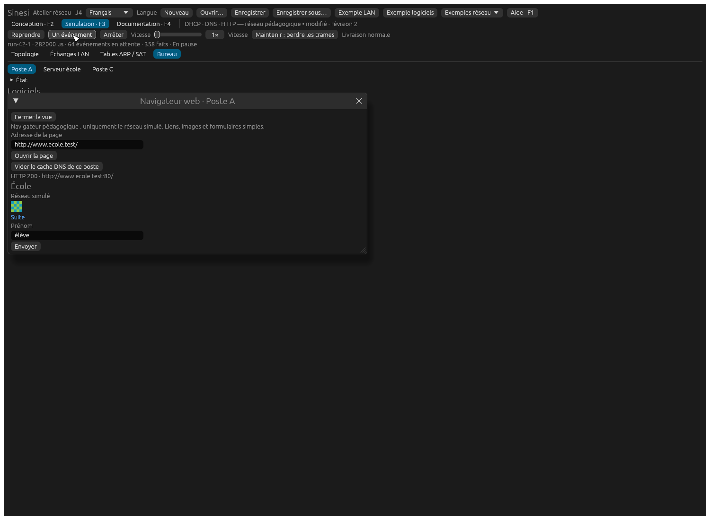

# Qualification J4 — DHCP, DNS et HTTP

Qualification locale du 7 novembre 2026. Les vingt exigences J4 et leurs cinq tâches sont reliées au [profil portable](../agnostique/SERVICES_J4.md), à l’[adaptateur](../rust/J4.md) et aux registres de suivi. Le projet reste hors ligne; aucune socket ou résolution système n’est employée par ces services.

## Résultats

| Contrôle exécuté | Résultat et preuve |
| --- | --- |
| `cargo test --workspace --locked --offline` | 113 tests réussis; une mesure de capacité historique ignorée, [journal](j4-tests.log) |
| `cargo test -p sns-engine --test services --locked --offline` | 12 recettes réussies, [journal](j4-recipes.log) |
| `cargo test -p sns-ui-egui --features ui-snapshots --test lan --test workbench --locked --offline` | 29 tests réussis, comparaison GPU sans mise à jour des références, [journal](j4-gpu.log) |
| `cargo fmt --all --check` | Réussi, [journal](j4-fmt.log) |
| `cargo clippy --workspace --all-targets --locked --offline -- -D warnings` | Réussi, [journal](j4-clippy.log) |
| `cargo build -p sns-desktop --locked --offline` | Binaire compilé, [journal](j4-build.log) |
| `python3 scripts/check_layers.py` | Frontières et dépendances vérifiées, [journal](j4-layers.log) |
| `python3 scripts/check_i18n.py` | 385 clés × six langues, paramètres et diagnostics vérifiés, [journal](j4-i18n.log) |
| `python3 scripts/check_network_assets.py` | Quatorze SVG et provenance conservés, [journal](j4-assets.log) |
| Documentation, registres et référence | Render, check avec référence et tests des garde-fous réussis, [journal](j4-docs.log) |

L’[environnement](j4-environment.json) précise système et outils. Le [manifeste](j4-code-manifest.json) couvre 196 fichiers, révision `0845cdf45f9a46a07ae3ae09cddb60e3665f1a18db995d611722f36764bc279c`. Les manifestes et captures des jalons précédents restent historiques.

## Correspondance des recettes

| Exigences | Preuves reproductibles |
| --- | --- |
| F-OS-004 | `r_dhcp_two_clients_reservation_effective_settings_and_document`; `j4_browser_ui_generates_http_for_page_link_image_and_form` vérifie le panneau effectif, la passerelle et le DNS; le document reste en DHCP |
| F-DHCP-001/002/003 | Deux baux distincts, réservation non distribuée à l’autre client, pool épuisé et options propres/héritées dans les tests `r_dhcp_*`, `dhcp_conflict_*`, `dns_and_http_cross_*` |
| F-DHCP-004/005/006 | Conflit ARP réel, Decline et NACK, libération/réacquisition du bail, expiration des refus, repli local et trois conflits finaux : `dhcp_conflict_*`, `dhcp_expiry_*`, `dhcp_nack_*`, `link_local_conflicts_*` |
| F-CLI-013 | `dns_mx_nodata_timeout_and_explicit_purge` et `dns_ttl_cache_is_per_host_and_delete_survives_reload` : host A/MX, nslookup, serveur, réponses et timeout |
| F-DNS-001/004/005/006 | Création/suppression typée, conservation du TTL, relecture de la sauvegarde, normalisation casse/point, purge, TTL écoulé et séparation des hôtes |
| F-DNS-002/003 | MX et A supplémentaires; NS parent/autorité, récursion activée et désactivée, boucle bornée dans `dns_parent_delegation_recursive_and_iterative_queries_and_bounded_loop` |
| F-WEB-001/002/003 | GET/index/404, POST UTF-8 échappé, méthode DELETE → 501, deux noms sur la même IP et dossiers distincts dans `r_web_*`, `http_methods_*` |
| F-WEB-004 | `network_browser_loads_png_bmp_gif_jpeg_from_simulated_http` produit les quatre formats, vérifie quatre requêtes distinctes et les décode avec le décodeur natif; captures du navigateur avec image |
| F-WEB-005 | `j4_browser_ui_generates_http_for_page_link_image_and_form` clique Suite/Accueil puis le formulaire et vérifie les faits HTTP; `strict_framing_and_offline_urls` refuse les sorties non HTTP |
| F-WEB-006 | `same_named_images_from_two_origins_and_navigation_are_isolated` et `r_web_*` : origine complète, deux navigateurs et invalidation à la navigation |
| Contrats et régressions | `service_profiles_commands_and_actual_trace_roundtrip_with_neutral_schemas` valide projet, commandes et chaque événement réel; tests J0–J3 et UDP générique 67/68 conservés |

Les tests réseau sont dans [services.rs](../../crates/sns-engine/tests/services.rs), le parcours natif simulé dans [lan.rs](../../crates/sns-ui-egui/tests/lan.rs), les quatre formats dans [service_images.rs](../../crates/sns-ui-egui/tests/service_images.rs), les schémas dans [contracts.rs](../../crates/sns-project/tests/contracts.rs). Le navigateur et les réglages DNS/HTTP sont testés dans chacune des six langues. Les styles Icônes/Schéma sont comparés sans mutation du projet.

## Reproduction des traces

```sh
SNS_RECORD_J4="$PWD/docs/verification" cargo test -p sns-engine --test services --locked --offline
python3 scripts/check_manifest.py check docs/verification/j4-code-manifest.json
python3 scripts/docs.py check --require-reference
```

Traces et configurations enregistrées : [DHCP](j4-dhcp.jsonl), [web](j4-web.jsonl), [conflit](j4-conflict.jsonl), [échec local borné](j4-link-local-failure.jsonl), [délégation itérative](j4-iterative.jsonl) et [récursive](j4-recursive.jsonl). Le code de chaque recette contient les commandes et bornes virtuelles de reproduction. Ces enregistrements proviennent des services du moteur, pas des messages du prototype J0.

## Contrôle graphique et limites

36 captures J4 conservent les vues générales et les écrans DNS/HTTP/navigateur en six langues. Les captures FR du navigateur/serveur web et DE du serveur DNS ont été inspectées visuellement. Le logo respecte désormais sa taille d’origine; les champs et le bouton du formulaire sont visibles. Les références J0–J3 sont conservées.



Les limites de fidélité sont explicites : messages DHCP/DNS structurés sur UDP, acquisition sans T1/T2 ni relais, absence de DNSSEC/TCP DNS, POST déclaratif et sous-ensemble HTML sans HTTPS, CSS ni scripts. La recette ne revendique pas une conformité aux protocoles binaires ni l’exécution des extensions historiques. Aucun essai natif Windows/Linux ou lancement distant de CI n’a été effectué. Le contrôle graphique repose ici sur le harnais natif rendu; aucun nouveau parcours manuel dans une fenêtre autonome n’est revendiqué.
