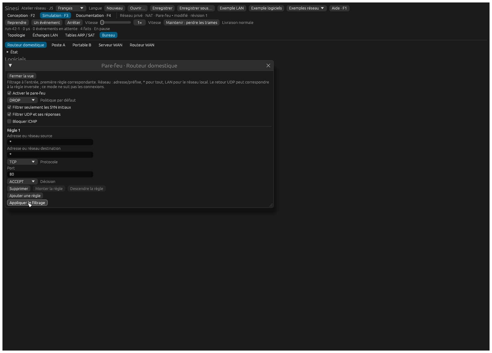

# Qualification J5 — Réseaux privés, NAT et filtrage

Qualification locale du 7 novembre 2026 : dix-sept exigences, six tâches, recettes R-NAT et R-FILTRE. Le [profil portable](../agnostique/RESEAUX_PRIVES_J5.md) décrit la sémantique; l’[adaptateur](../rust/J5.md) décrit les modules. Les preuves précédentes restent historiques.

## Contrôles exécutés

| Commande | Résultat |
| --- | --- |
| `cargo test --workspace --locked --offline` | **134 tests réussis**, une mesure de capacité historique ignorée, [journal](j5-tests.log) |
| `cargo test -p sns-engine --test private --locked --offline` | **15 recettes réussies**, [journal](j5-recipes.log) |
| `cargo test -p sns-ui-egui --features ui-snapshots --test lan --test workbench --locked --offline` | **34 tests réussis**, comparaison sans mise à jour des captures, [journal](j5-gpu.log) |
| `cargo fmt --all --check` | Réussi, [journal](j5-fmt.log) |
| `cargo clippy --workspace --all-targets --locked --offline -- -D warnings` | Réussi, [journal](j5-clippy.log) |
| `cargo build -p sns-desktop --locked --offline` | Binaire compilé, [journal](j5-build.log) |
| `python3 scripts/check_layers.py` | Graphe de production indépendant du rendu et des sockets système, [journal](j5-layers.log) |
| `python3 scripts/check_i18n.py` | **439 clés × six langues**, diagnostics et paramètres vérifiés, [journal](j5-i18n.log) |
| `python3 scripts/check_network_assets.py` | Quatorze SVG et provenance conservés, [journal](j5-assets.log) |
| Contrôle documentaire et des registres | Render, check avec référence et tests des garde-fous réussis, [journal](j5-docs.log) |

L’[environnement](j5-environment.json) précise les outils. Le [manifeste](j5-code-manifest.json) couvre 262 fichiers source, révision `c9141fba7463f66ad8248df45d6f7713553ec93255190fa7378daf8195bc77df`. Il comprend les contrats, fixtures et captures actuels. Les sources de l’archive n’ont pas été modifiées et leur audit n’a pas été recalculé.

## Correspondance avec les exigences

Les tests réseau sont dans [private.rs](../../crates/sns-engine/tests/private.rs), les interactions natives dans [lan.rs](../../crates/sns-ui-egui/tests/lan.rs), la création/persistance des rôles dans [editor.rs](../../crates/sns-topology/tests/editor.rs), les contrats dans [contracts.rs](../../crates/sns-project/tests/contracts.rs).

| Exigences | Qualification |
| --- | --- |
| F-EQU-004 | `home_router_has_persistent_lan_wan_roles_and_no_profile_downgrade` et `j5_home_router_roles_views_and_six_languages_are_preserved` : deux interfaces, labels de câblage, sauvegarde, undo/redo et deux styles dans six langues |
| F-NAT-001/002 | `nat_tcp_same_ports_restore_to_correct_hosts_and_keep_original_trace`, `nat_udp_same_ports_isolate_reply_endpoints` : même port source, mappings publics distincts, réponses aux bons postes et préfixe de trace inchangé |
| F-NAT-003 | `static_forward_and_icmp_traceroute_quotes_traverse_nat`, `static_udp_forward_and_wan_private_scope_guard` : TCP 8080→80 et UDP 8080→9001, retour avec le port public, frontière WAN conservée |
| F-NAT-004 | Ping et traceroute de deux postes, traduction des erreurs citées; `wan_arp_failure_quotes_the_original_private_probe` restitue aussi les erreurs d’échec ARP WAN |
| F-NAT-005 | Purge, expiration et réutilisation des ports, saturation explicite dans `mapping_purge_expiry_and_port_exhaustion_are_observable` et `idle_udp_mapping_expires_then_port_can_be_reused_and_invalid_edits_are_atomic` |
| F-NAT-006 | `wan_dhcp_and_lan_distribution_are_independent_and_expiry_keeps_lan_administration` : trois acquisitions, options distinctes, NAT fonctionnel et écoute LAN conservée après expiration WAN; une attribution WAN chevauchant le LAN est refusée explicitement |
| F-FW-001/002/003 | Filtre hôte/routeur, activation/arrêt, premières règles contradictoires, réordonnancement, politique, adresses/préfixes et ports : `firewall_order_policy_icmp_and_udp_reverse_matching`, `host_filter_blocks_one_service_and_preserves_http_when_icmp_is_blocked` |
| F-FW-004/005 | `filter_udp_reverse_rule_icmp_switch_and_syn_only_are_explicit` distingue SYN seul/tous segments et démontre le retour UDP inversé; ICMP bloqué laisse HTTP autorisé fonctionner |
| F-FW-006/007 | Décisions corrélées à une trame/règle, formulaire HTTP ajoutant la règle et journal web reflétant son application : `web_rule_changes_are_applied_and_the_journal_reports_the_rule_and_packet`; CRUD natif qualifié dans les six langues |
| F-WEB-007/F-ROUT-006 | Administration HTTP réelle du simulateur, route issue de la même table, modification de politique/redirection, refus WAN et formulaire obsolète : `administration_over_real_http_updates_shared_configuration_and_rejects_stale_or_wan_forms`; le parcours graphique vérifie la convergence du document |
| F-OBS-007 | `j5_nat_table_updates_and_purges_without_reopening_the_panel` observe un mapping créé par un ping puis le purge; SAT et vues historiques sont conservées |
| Contrats et déterminisme | `private_network_profiles_commands_nat_and_quoted_icmp_match_neutral_contracts` valide les événements réels, y compris les paquets cités; `private_network_workflows_have_identical_canonical_traces` compare les octets de deux exécutions |

La copie des paquets avant/après NAT est qualifiée sur le transport de production. Le routeur WAN de l’exemple ne possède initialement aucune route vers le LAN : le succès des réponses dépend donc de la traduction. Un test lui ajoute ensuite volontairement une route privée pour vérifier que la frontière WAN la refuse malgré cette route.

## Reproduction

```sh
SNS_RECORD_J5="$PWD/docs/verification" cargo test -p sns-engine --test private --locked --offline
python3 scripts/check_manifest.py check docs/verification/j5-code-manifest.json
python3 scripts/docs.py check --require-reference
```

Les tests contiennent les commandes et bornes virtuelles complètes. Les traces enregistrées et leurs projets sont [NAT TCP](j5-nat-tcp.jsonl), [ICMP et redirection](j5-icmp-forward.jsonl), [DHCP WAN/LAN](j5-wan-dhcp.jsonl), [expiration](j5-expiration.jsonl) et [règle/journal web](j5-web-filter.jsonl). La variante `SNS_RECORD_J5` enregistre les sorties de ces recettes sans modifier leur exécution.

## Contrôle graphique et limites

56 captures J5 couvrent les écrans conservés, les fenêtres pare-feu et administration ainsi que la table NAT dans FR/EN/ES/IT/PT/DE, puis l’exemple privé en Icônes/Schéma. Les captures françaises du pare-feu, de l’administration et du schéma, et la table NAT allemande ont été inspectées. Les vues restent bornées et défilantes; les références J0–J4 sont conservées.



Les résultats sont ceux d’un profil pédagogique : filtre Ethernet entrant, mode SYN/UDP historique sans suivi complet, traduction de paquets typés sans sommes de contrôle binaires, pas de hairpin ni d’IPv6. L’administration interne est limitée au LAN mais ne revendique ni HTTPS ni authentification. Les limites et l’ordre de traitement figurent dans le profil portable. La validation graphique repose sur le harnais rendu; aucun nouveau parcours manuel en fenêtre autonome, essai natif Windows/Linux ou lancement de CI distante n’est revendiqué.
