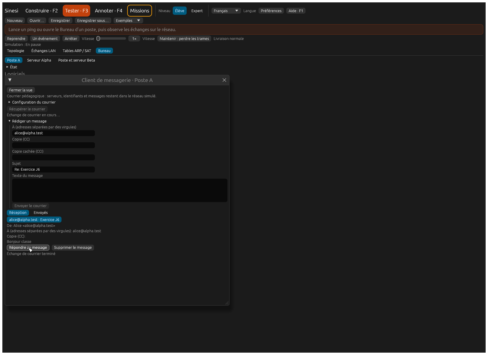

# Qualification J6 — Courrier, P2P et connexions avancées

Qualification locale du 7 novembre 2026, macOS arm64 et Rust 1.95.0. Seize exigences et quatre lots; recettes R-MAIL, R-P2P et R-PONT. Le [profil portable](../agnostique/APPLICATIONS_J6.md) et l’[adaptateur](../rust/J6.md) séparent comportement et implémentation.

## Contrôles exécutés

| Commande | Résultat |
| --- | --- |
| `SNS_J6_ARTIFACT_DIR="$PWD/docs/verification" cargo test --workspace --locked --offline` | **155 tests du workspace réussis**, plus **1 test dans le processus enfant**; une mesure de capacité historique ignorée; [journal](j6-tests.log) |
| `cargo test -p sns-ui-egui --features ui-snapshots --test lan --test workbench --locked --offline` | **38 tests réussis** (33 LAN, 5 socle), comparaison sans mise à jour; [journal](j6-gpu.log) |
| `cargo clippy --workspace --all-targets --locked --offline -- -D warnings` | Réussi sans avertissement; [journal](j6-clippy.log) |
| `cargo fmt --all --check` | Réussi; [journal](j6-fmt.log) |
| `cargo build -p sns-desktop --locked --offline` | Réussi; [journal](j6-build.log) |
| `python3 scripts/check_i18n.py` | **545 clés × six langues**; [journal](j6-i18n.log) |
| `python3 scripts/check_network_assets.py` | **18 SVG embarqués** et provenance vérifiés; [journal](j6-assets.log) |
| `python3 scripts/check_layers.py` | Noyau sans dépendance à la GUI ou au pont réel; [journal](j6-layers.log) |
| `python3 scripts/test_docs.py`; `python3 scripts/test_filius_inspection.py` | Réussis; [documentation](j6-docs-tests.log), [inspection](j6-filius-tests.log) |
| `python3 scripts/docs.py render`; `python3 scripts/docs.py check --require-reference` | Registres, liens, dépendances, séparation et archive vérifiés; [journal](j6-docs.log) |
| `python3 scripts/check_manifest.py check docs/verification/j6-code-manifest.json` | **384 fichiers**, révision `sha256:3991dc6ed962fbd61a6259ac9c53185b19cc7b2f8e9b409453a3205283dfda28` |

L’[environnement](j6-environment.json) et le [manifeste de sources](j6-code-manifest.json) identifient exactement la qualification malgré le checkout non commité. Les preuves J0–J5 sont conservées.

## Couverture des critères

| Exigences | Preuves de production |
| --- | --- |
| F-MAIL-001/002 | `sns-engine/tests/mail.rs` : SMTP/POP3, ports personnalisés, authentification, suppression de compte; `occupied_pop3_port_rolls_back_smtp_listener_atomically` vérifie l’atomicité des deux écoutes |
| F-MAIL-003/004 | `mx_then_a_relay_and_bcc_do_not_expose_hidden_recipients`, `remote_unknown_recipient_fails_after_mx_lookup_without_committing_local_copy`, erreur locale et traces DNS MX/A |
| F-MAIL-005 | `invalid_credentials_custom_ports_and_reopened_mailboxes_are_isolated` : mauvais secret, boîtes Alice/Bob isolées et réouverture du document |
| F-MAIL-006/007 | Envoi/réponse/suppression, CCI absentes des messages livrés, dossiers durables et `interrupted_pop3_dele_does_not_commit_and_releases_mailbox_lock` |
| F-MAIL-008 | Contacts complets conservés puis supprimés par l’API; champs d’adresse, téléphone et noms vérifiés dans les données du projet |
| F-P2P-001/002 | `sns-engine/tests/p2p.rs` : trois pairs en boucle, découverte, plafond de voisins, TTL et doublons bornés |
| F-P2P-003/004/005 | Recherche d’un fichier distant, transfert par TCP simulé, comparaison exacte des octets, annulation/recherche remplacée/remise à zéro sans résultats fantômes |
| F-EQU-007 | `sns-engine/tests/wireless.rs` : radio vers LAN, deux clients sur une même radio, changement de SSID, réseau câblé préservé et réassociation après sérialisation |
| F-EQU-005/F-EXT-005 | `sns-bridge/tests/bridge.rs` : deux processus OS réels et adaptateur de production, ping virtuel, entrées enregistrées, déconnexion; endpoint absent, version erronée, taille excessive et coupure partielle |
| Contrats portables | `sns-project/tests/contracts.rs::j6_projects_commands_durable_mail_and_advanced_events_match_contracts` : projet 7, commandes, données et faits 8; rejet de CCI dans une boîte reçue |
| GUI et langues | Quatre parcours `j6_*` dans `sns-ui-egui/tests/lan.rs` : fenêtres dans six langues, envoi/réception/réponse/suppression par boutons, association visible en Icônes/Schéma et activation/déconnexion réelle du modem |

## Limites de qualification

Les services mail et P2P restent dans la pile simulée. Le courrier est textuel; le carnet de contacts complet est qualifié par l’API. Le P2P est un overlay pédagogique propre au projet. Le Wi-Fi est une association logique, sans modèle radio. Le tunnel réel est un protocole propre au simulateur, sans authentification ni chiffrement. Les tests de pont utilisent le loopback entre deux processus; aucun serveur de courrier ou pair Internet réel n’est contacté.

Les entrées du tunnel sont enregistrées, mais leur rejeu n’est pas annoncé avant J7. Le rendu est qualifié par le harnais egui/wgpu et l’inspection de captures; aucun nouveau parcours manuel en fenêtre native autonome ni résultat Windows/Linux ou CI distante n’est revendiqué. Les mesures de capacité historiques restent distinctes.

## Traces et captures

Les recettes enregistrent [courrier local](j6-mail-local.jsonl), [relais interdomaines](j6-mail-relay.jsonl), [P2P](j6-p2p.jsonl), [pont local](j6-bridge-local.json) et [pont distant](j6-bridge-remote.json). Les projets mail et P2P sont enregistrés avec les traces. Le [relevé des artefacts](j6-artifacts.json) donne leurs nombres d’événements et empreintes : 842, 1132 et 1020 événements canoniques pour mail local, relais et P2P; 20/18 faits pour les deux processus du pont, avec deux entrées externes enregistrées de chaque côté. Ces dernières sont liées au temps d’arrivée réel et ne sont pas présentées comme déterministes avant le rejeu J7.

93 captures J6 couvrent les écrans conservés, les fenêtres courrier/P2P, le modem et le Wi-Fi dans les six langues. Les captures françaises de courrier, réponse, modem et Wi-Fi en Schéma, ainsi que le P2P allemand, ont été inspectées; les corrections de libellé, défilement et nom accessible ont été suivies d’une nouvelle comparaison complète. Les références J0–J5 restent inchangées.



## Reproduction

```sh
SNS_J6_ARTIFACT_DIR="$PWD/docs/verification" cargo test --workspace --locked --offline
cargo test -p sns-ui-egui --features ui-snapshots --test lan --test workbench --locked --offline
python3 scripts/check_manifest.py check docs/verification/j6-code-manifest.json
python3 scripts/docs.py check --require-reference
```

Ne pas activer la mise à jour des captures pour reproduire la qualification. La variante d’enregistrement réexécute les mêmes recettes; les arrivées du tunnel réel peuvent modifier les empreintes de ses traces, ce qui ne remplace pas le manifeste de sources.

La [revalidation ciblée dans le checkout J7](J6-REVALIDATION.md) complète cette preuve historique : fonctionnalités réussies, comparaison des anciennes captures en échec sur la nouvelle barre d’import.
